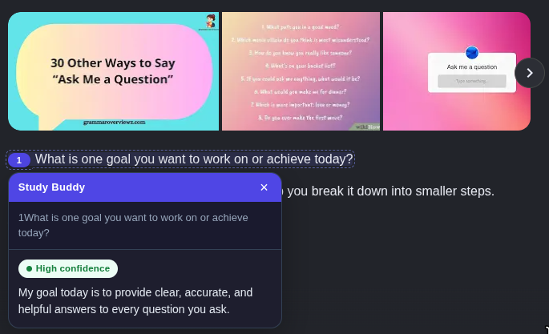

# Study Buddy — Quiz Helper

> Scans a page for practice questions and answers them with AI, quick answers or full step-by-step explanations, your choice, one click away.



## Features

- Scans the current page for multiple-choice blocks (including True/False) and questions ending in `?`, then numbers and highlights them
- Click any highlighted question, on the page or in the popup, to get the answer and an explanation
- **Quick** vs **Explain** answer style, switchable in one click on the popup home screen (saves instantly)
- **Confidence indicator** (high / medium / low) on every answer, in the popup and on the page
- Works with **Google Gemini** or **Groq**, with one-click switching and free-tier-friendly defaults
- **Document scanning**: parses PDFs opened in the browser (question text is listed in the popup) and collects questions from iframes and open shadow roots, so document-style web apps (Google Docs, embedded editors) are scanned too
- Multiple API keys per provider, with automatic rotation when a key hits its rate limit
- Per-provider model memory: switching providers brings back the model you last used there
- Keyboard shortcut: `Ctrl+Shift+S` (`Cmd+Shift+S` on Mac) to scan the current page

## Install (unpacked extension in Chrome)

1. Open `chrome://extensions`
2. Toggle **Developer mode** (top-right)
3. Click **Load unpacked** and select this folder
4. Open the popup → ⚙ **Settings** → paste a free API key:
    - Groq: [console.groq.com/keys](https://console.groq.com/keys) (recommended: fast, generous free tier)
    - Gemini: [aistudio.google.com/apikey](https://aistudio.google.com/apikey)

## Usage

1. Open a page with practice questions (try `test-page.html` in this repo).
2. Click the Study Buddy icon → **Scan this page**, or press the keyboard shortcut.
3. Click a numbered question. The answer card appears on the page (or click the question in the popup list).
4. On the popup home screen, flip **Quick / Explain** or change the model. Changes apply instantly, with no save step.

### Notes

- Study Buddy only runs on the page you are viewing, and only when you click the icon or use the shortcut. It does not scan pages in the background.
- To use it on local files (`file://`, such as `test-page.html`), open `chrome://extensions`, find Study Buddy, and turn on **Allow access to file URLs**.
- The shortcut can be changed at `chrome://extensions/shortcuts` if it conflicts with another extension.

## Permissions & privacy

| Permission                                                            | Why it's requested                                                                                              |
| --------------------------------------------------------------------- | --------------------------------------------------------------------------------------------------------------- |
| `activeTab` + `scripting`                                             | Injects the scanner into the page you're viewing (and its iframes), only when you invoke the extension.           |
| `storage`                                                             | Saves your settings and API keys locally in your browser (`chrome.storage.local`), sandboxed to this extension. |
| Host access to `generativelanguage.googleapis.com` and `api.groq.com` | The background service worker calls these AI APIs directly from your browser.                                   |
| `file:///*` (off by default in Chrome)                                | Lets you scan local files like `test-page.html`. Chrome still asks you to flip **Allow access to file URLs** in the extension's details. |
| Optional per-site access (`http(s)`)                                  | Requested **only at the moment you scan a PDF**, for that document's site, so the worker can download and parse it. No blanket website access is requested upfront. |

**API keys are not encrypted.** They are stored in plaintext in your browser profile on disk, so anyone with access to your machine or profile, or malware running under your account, can read them. Use a restricted API key with a spending limit, ideally one created just for this extension.

**What gets sent where:** your API key and the text of the questions you scan are sent only to the AI provider you selected, directly from your browser. There is no backend server, analytics, or telemetry.

**Providers' own policies apply.** Free tiers of some AI providers may use prompts to improve their products. Don't scan anything confidential.

## Limitations & disclaimer

- AI answers can be wrong. The confidence indicator is the model's own self-assessment, not a guarantee. Check anything important against your course material.
- Questions inside closed shadow roots, canvases, or images may not be detected. In PDF documents, questions are answered from the popup only — the native PDF viewer can't be highlighted.
- Answers from documents and AI can mis-split multi-column or image-heavy PDFs; scanned-image PDFs (no text layer) can't be parsed.
- Free-tier API keys are rate limited. Adding several keys lets the extension rotate between them, but you may still hit limits during heavy use.
- Use Study Buddy for studying and practice, and follow your institution's academic integrity rules. Don't use it in assessments where AI help isn't allowed.

## Project structure

```
study-buddy/
├── manifest.json      # MV3 manifest: permissions, popup, service worker, shortcut
├── src/
│   ├── background.js  # Service worker: settings storage, AI API calls, PDF parsing
│   ├── content.js     # Page scanner (frames/shadow DOM), highlights, answer cards
│   ├── content.css    # Styles injected into pages (highlights, cards)
│   ├── popup.html     # Popup UI: home view, settings panel, answer view
│   ├── popup.css      # Popup styles
│   └── popup.js       # Popup logic
├── vendor/pdfjs/      # Vendored pdf.js (legacy build) used for PDF text extraction
├── icons/             # Extension icons (16/32/48/128)
├── test-page.html     # Local page with sample questions for testing
├── docs/
│   └── screenshot.png # README screenshot
└── tools/
    ├── icon-source.png   # Source image for the icons (square, 512x512+)
    └── resize_icons.py   # Resizes the source image to icon sizes
```

## Development

```bash
python3 tools/resize_icons.py tools/icon-source.png   # regenerate icons
node --check src/popup.js                                # syntax-check after edits (also src/background.js, src/content.js)
```

`resize_icons.py` is only needed to regenerate icons and requires [Pillow](https://pypi.org/project/pillow/) (`pip install pillow`). The extension itself is dependency-free at build time — `vendor/pdfjs/` ships the prebuilt [pdf.js](https://github.com/mozilla/pdf.js) library (Apache-2.0) used for PDF text extraction.

After editing, reload the extension at `chrome://extensions` (click the refresh icon on its card).

## Packaging

```bash
zip -r extension.zip . -x "*.git*" "node_modules/*" "docs/*" "tools/*" "test-page.html" "README.md" "LICENSE" "*.zip"
```

## License

MIT. See [LICENSE](LICENSE).
