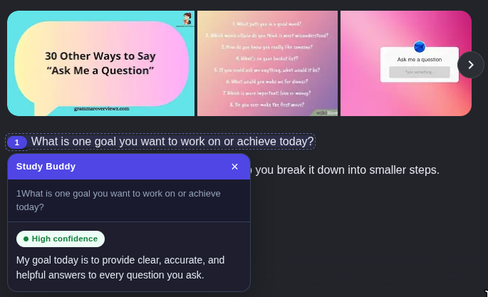

<div align="center">


</div>

A Chrome extension that scans the page you're on for practice questions and answers them with AI. Choose a quick answer or a full step-by-step explanation, one click away. It runs entirely in your browser, with no backend, analytics or telemetry.



## Features

**Scanning**
- Finds multiple-choice blocks (including True/False) and questions ending in `?`, then numbers and highlights them. On pages with iframes, the badges match the popup's numbering exactly.
- Reads PDFs opened in the browser and lists their questions in the popup.
- Collects questions from iframes and open shadow roots, so document-style web apps like Google Docs and embedded editors are scanned too.

**Answering**
- Click any highlighted question, on the page or in the popup, to get the answer and an explanation.
- **Quick** or **Explain** style, switchable in one click. Switching style or model always re-answers and never serves a stale cached answer.
- A **confidence indicator** (high / medium / low) on every answer, in the popup and on the page.

**Setup**
- Works with **Google Gemini** or **Groq**, with one-click switching and free-tier-friendly defaults.
- Multiple API keys per provider, with automatic rotation when a key hits its rate limit.
- Remembers the model you last used for each provider.
- **Dark mode** for the popup, page highlights and answer cards, updating live.
- Shortcut: `Ctrl+Shift+S` (`Cmd+Shift+S` on Mac) scans the current page.

## Install

Needs Chrome or Chromium **109+** (the PDF scanner uses offscreen documents). Recent Chromium-based browsers work too.

```console
1. Open chrome://extensions
2. Turn on Developer mode (top right)
3. Click Load unpacked and select this folder
4. Open the popup → ⚙ Settings → paste a free API key
```

| Provider | Get a key | Notes |
|---|---|---|
| **Groq** | [console.groq.com/keys](https://console.groq.com/keys) | Recommended: fast, with a generous free tier |
| **Gemini** | [aistudio.google.com/apikey](https://aistudio.google.com/apikey) | Free tier available |

## Usage

1. Open a page with practice questions (`test-page.html` in this repo works).
2. Click the Study Buddy icon and choose **Scan this page**, or press the shortcut.
3. Click a numbered question. The answer card appears on the page, or click the question in the popup list.
4. Flip **Quick / Explain** or change the model on the popup home screen. Changes apply instantly with no save step.

**Good to know**
- It only runs on the page you're viewing, and only when you click the icon or use the shortcut. Nothing is scanned in the background.
- For local files like `test-page.html`, open `chrome://extensions`, find Study Buddy and turn on **Allow access to file URLs**.
- If the shortcut clashes with another extension, change it at `chrome://extensions/shortcuts`.

## Permissions and privacy

| Permission | Why it's requested |
|---|---|
| `activeTab` + `scripting` | Injects the scanner into the page you're viewing (and its iframes), only when you invoke the extension. |
| `storage` | Saves settings and API keys locally in `chrome.storage.local`, sandboxed to this extension. |
| Host access to `generativelanguage.googleapis.com` and `api.groq.com` | The background service worker calls these AI APIs directly from your browser. |
| `file:///*` (off by default in Chrome) | Lets you scan local files. Chrome still asks you to turn on **Allow access to file URLs**. |
| Optional per-site access (`http(s)`) | Requested **only when you scan a PDF**, for that document's site, so the worker can download and parse it. No blanket website access upfront. |

> [!WARNING]
> **API keys are not encrypted.** They're stored in plaintext in your browser profile on disk, so anyone with access to your machine or profile, or malware running under your account, can read them. Use a restricted key with a spending limit, ideally one made just for this extension.

**What gets sent where:** your API key and the text of the questions you scan go only to the AI provider you selected, directly from your browser.

**Providers' own policies apply.** Free tiers of some AI providers may use prompts to improve their products. Don't scan anything confidential.

## Limitations

- **AI can be wrong.** The confidence indicator is the model's own self-assessment, not a guarantee. Check anything important against your course material.
- **Detection gaps.** Questions inside closed shadow roots, canvases or images may not be found. Open shadow roots (Google Docs-style apps) are scanned and cleaned up correctly, even across rescans.
- **PDFs.** Questions are answered from the popup only, because the native PDF viewer can't be highlighted. Multi-column or image-heavy PDFs can be mis-split, and scanned-image PDFs with no text layer can't be parsed. Scans stop after 90 seconds, so try a shorter file if a big one times out.
- **Reasoning-heavy models** (Groq's gpt-oss, some Gemini Flash versions) spend part of the token budget on hidden "thinking". The extension caps this and retries once with a larger budget, but on stubborn answers a lighter model is more reliable.
- **Rate limits.** Free-tier keys are rate limited. Several keys help, but heavy use can still hit the limit.

> [!IMPORTANT]
> Use Study Buddy for studying and practice, and follow your institution's academic integrity rules. Don't use it in assessments where AI help isn't allowed.

## Project structure

```text
study-buddy/
├── manifest.json          MV3 manifest: permissions, popup, service worker, shortcut
├── src/
│   ├── background.js      service worker: settings, AI API calls, PDF parsing
│   ├── shared-models.js   provider/model list shared by popup and worker
│   ├── shared-renderer.js answer rendering shared by popup and pages
│   ├── content.js         page scanner (frames/shadow DOM), highlights, answer cards
│   ├── content.css        styles injected into pages
│   ├── offscreen.html     hidden page host for PDF extraction
│   ├── offscreen.js       PDF text extraction (pdf.js needs DOM + dynamic import)
│   ├── popup.html         popup UI: home, settings, answer view
│   ├── popup.css          popup styles
│   └── popup.js           popup logic
├── vendor/pdfjs/          vendored pdf.js (legacy build)
├── icons/                 extension icons (16/32/48/128)
├── test-page.html         local page with sample questions
├── docs/screenshot.png    README screenshot
└── tools/
    ├── icon-source.png    source image for the icons (square, 512x512+)
    └── resize_icons.py    resizes the source image to icon sizes
```

## Development

```bash
python3 tools/resize_icons.py tools/icon-source.png   # regenerate icons
node --check src/popup.js                             # syntax-check after edits
# also: background.js, content.js, offscreen.js, shared-models.js, shared-renderer.js
```

`resize_icons.py` is only for regenerating icons and needs [Pillow](https://pypi.org/project/pillow/) (`pip install pillow`). The extension itself has no build-time dependencies: `vendor/pdfjs/` ships the prebuilt [pdf.js](https://github.com/mozilla/pdf.js) library (Apache-2.0).

After editing, reload the extension at `chrome://extensions` with the refresh icon on its card.

## Packaging

```bash
zip -r extension.zip . -x "*.git*" "node_modules/*" "docs/*" "tools/*" "test-page.html" "README.md" "LICENSE" "*.zip"
```

## License

MIT. See [LICENSE](LICENSE).

<div align="center">
<sub>Built by <a href="https://github.com/Herbertbuilds">Herbert Jantjies</a></sub>
</div>
